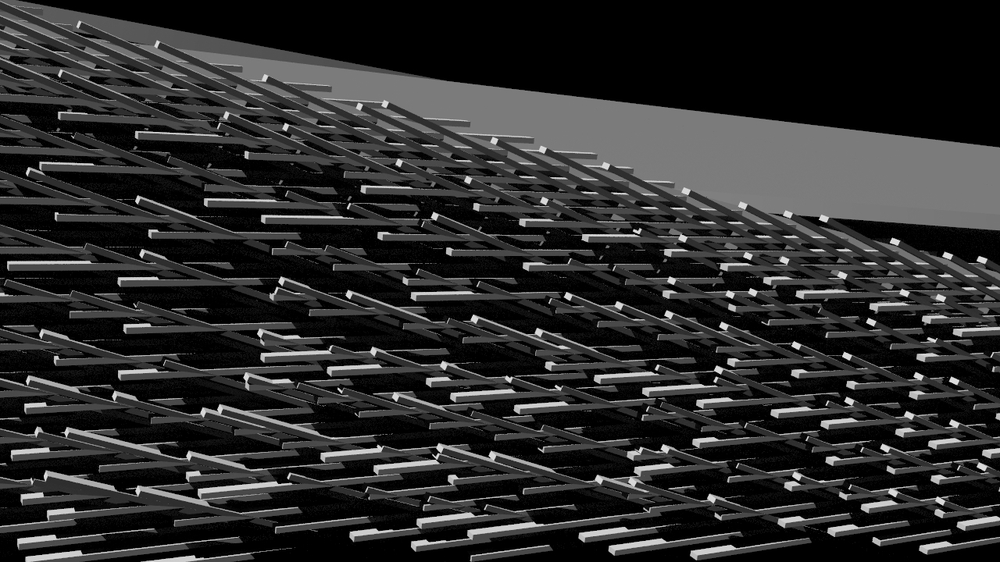

<!--
_color: white
-->

# ファザード生成ツール

Brightnessを落とし、文字の視認性を上げました

---

### 左に画像をいれる

- 表示場所、比率を指定する
- 次頁では、複数画像を並べます
- footerで画像クレジット表示も

---

<!--
_backgroundColor: white
_footer: 'Photo by Chris Campbell, Dan on Unsplash'
-->

# 進め、
#### 新しいわたし。

<small>
なんて、  
小洒落た感じにも。
</small>

---
