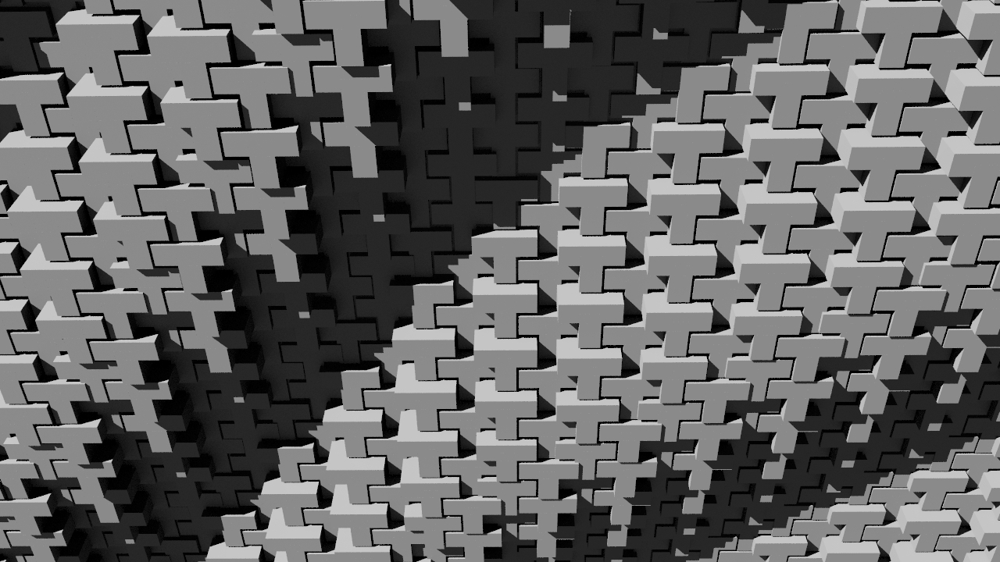
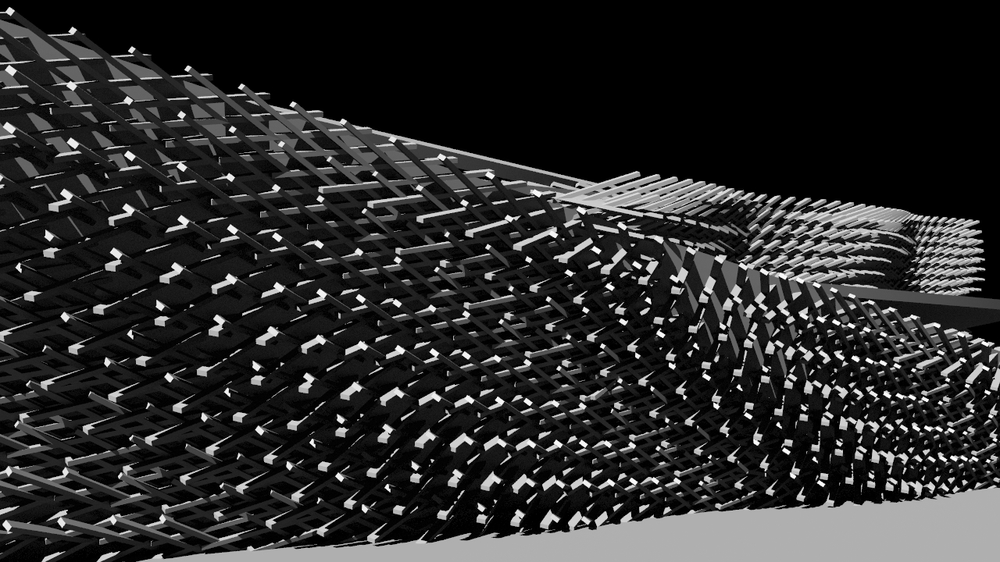
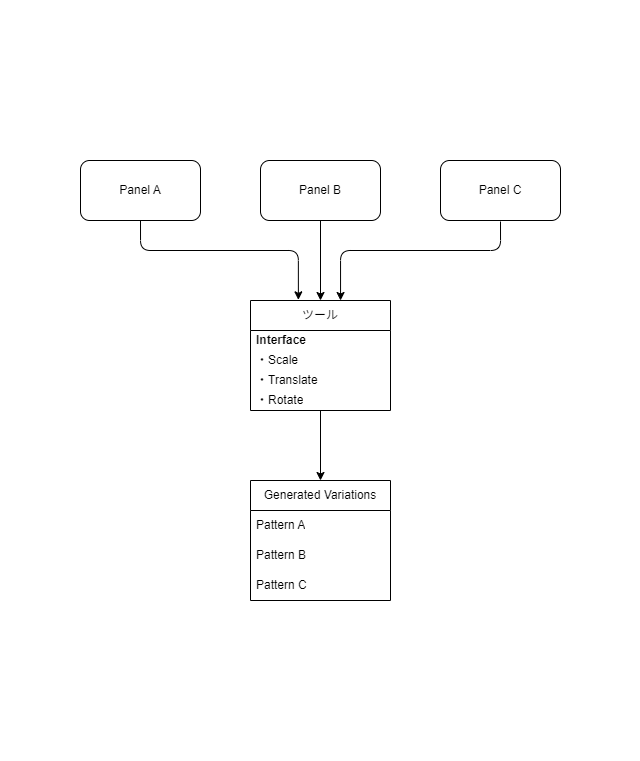
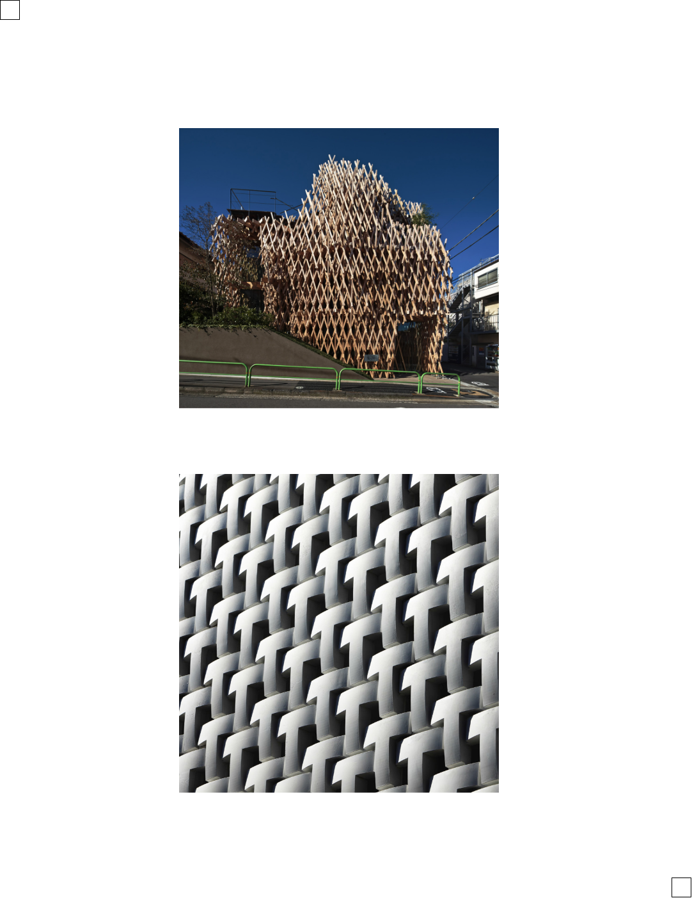
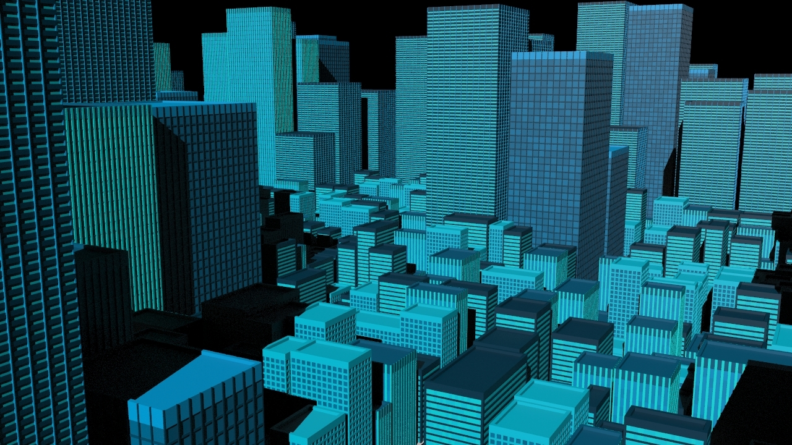
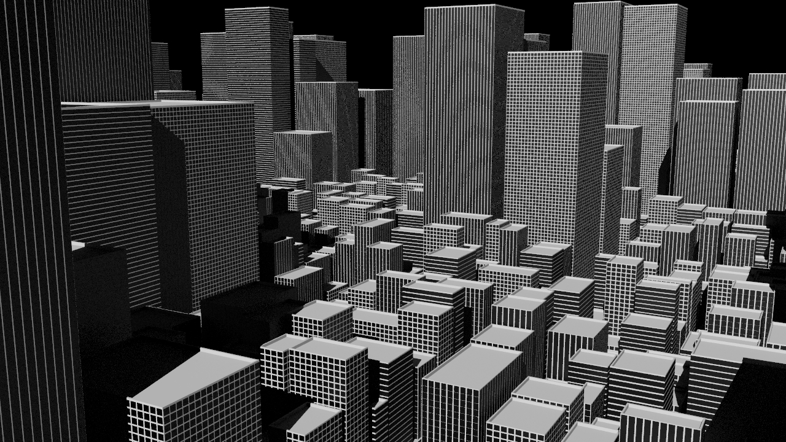
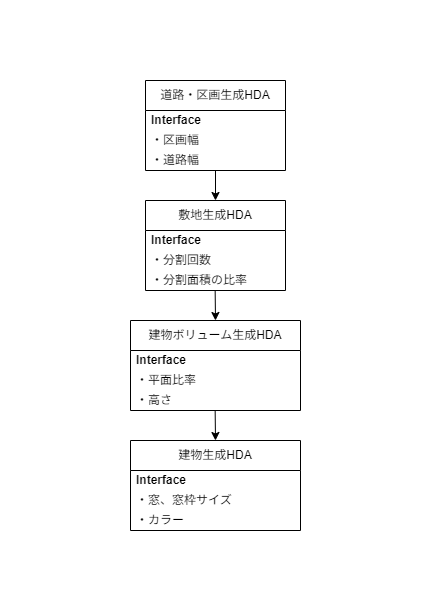
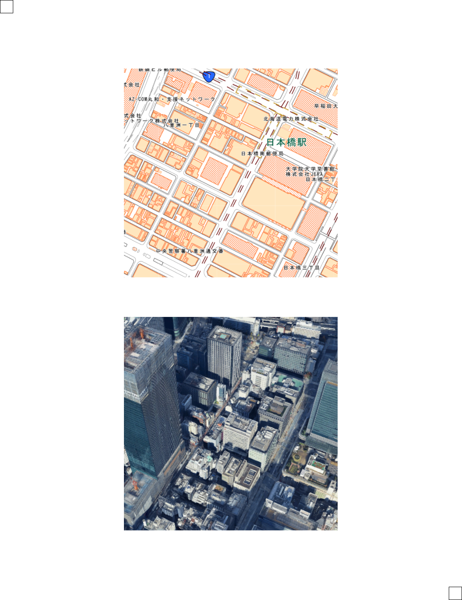
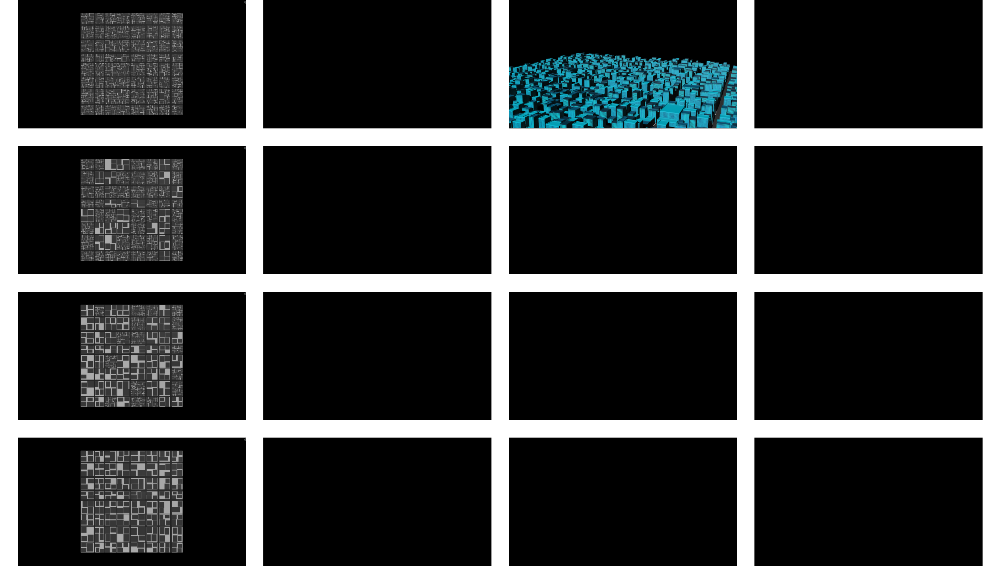

# ポートフォリオ
## 中村優介

業務で実装したツールについては機密保持の都合上、詳細を掲載していない。
その代わりに、Grasshopperと同様のビジュアルスクリプトベースのプロシージャルモデリングソフトである Houdini を用い、
自主的にコンピュテーショナルデザインおよびプロシージャルデザインの検証を行った作品を本ポートフォリオに掲載している。

---

<!--
_color: white
-->

# ファサード生成ツール

コンピュテーショナルデザインにおけるファサード設計をルール化し、
パネル形状と配置ロジックを柔軟に変更可能なツールを実装した。
本ツールを使用することで多様なファサードバリエーションを効率的に検証、生成できる。

---

## 目的・背景

コンピュテーショナルデザインにおけるファサード設計初期段階では、配置密度・リズム・不均質性などを反復的に検討する必要がある。

本ツールは、こうした検討を効率的に行うことを目的として以下の点に着目して実装した。

* 反復作業・バリエーション検討の効率化  
* ルール設計と形状生成の関係性の検証
* 生成プロセスそのものの再利用性の確保

---

## アプローチ / 設計思想

### バリエーション × ポリモーフィズム

本設計では形状ごとに専用ロジックを持たせるのではなく、  
共通の生成ルールを用いて多様な形状に対応できる構成を
目指し、下記項目に基づいて設計を行っている

- 入力として任意のパネル形状モデルを受け取る設計  
- 同一のインターフェースで異なる形状に対応できる  
  ポリモーフィズム的構成  
- 生成ロジックをカプセル化し、  
  パラメーター操作のみで形状バリエーションを生成  

---

## 実装内容

### パネル形状の引数化
パネル形状をモジュール内部に固定せず、
引数として入力可能な設計とした。  
これにより、表現の差し替えや複数案の比較を容易にし、
同一ロジックを用いた高い再利用性を確保している。

### パラメーターによる柔軟な制御
配置ルールをパラメーター化することで、パネルの
スケール・配置位置・回転・反復ルールを制御可能とした。  
これにより、均質から不均質まで幅広いファサード表現を
検証可能にしている。

---

### ツール検証

SunnyHillsおよび蔦屋書店のファサードを
モチーフとして検証を行った。

木組み構造とT形状のブロックを引数として用意し  
ツールの引数に設定することで、
異なるパネル形状に対しても同一ルールで
ファサード生成を行っている。

また、配置ルールをパラメーターで調整することで、
多様なファサードバリエーションを生成している。

---

---

<!--
_color: white
-->

# 街生成ツール
街並みの構成をプロシージャルに行う、街生成ツールを実装した。

道路・区画・建物ボリュームの生成を段階的に行い、
パラメーターによってスケールや密度を柔軟に調整することで、
多様な街並みを効率的に検証、生成できる。

---

## 目的・背景

街並みは多様な構成要素とスケールを持つ。

こうした多様性に対応するため、各工程をカプセル化し、
柔軟なパラメーターによって構成を制御することで、
街並みの特徴を柔軟に表現できる
プロシージャルな街生成ツールを実装した。

---

## アプローチ・設計思想

### 処理のカプセル化
- 街生成の処理を細かく分割し、  
  それぞれを独立したモジュールとして実装  
- 各工程をカプセル化しつつ
  組み合わせによる拡張性を確保

### パラメーターによる柔軟な制御
- 街の形状やスケールを数値的にコントロール可能  
- 各処理に必要なパラメーターを設定

---

## 実装内容

街生成の処理を、以下の4段階に分けてツール実装している。

- **1. 道路・区画生成ツール**
道幅や間隔をパラメーターとして制御し、  
道路と区画を生成する。

- **2. 敷地生成ツール**
区画内部を分割し、
敷地サイズや分割比率を調整可能な形で敷地を生成する。

- **3. 建物ボリューム生成ツール**
敷地に対する占有率や高さをパラメーターとして、  
建物のベースとなるボリュームを生成する。

- **4. 建物生成ツール**
ボリュームを入力とし、モジュラーモデリング、  
プロシージャルモデリングによって建物を生成する。

各工程の処理を独立させることで  
差し替えや拡張を前提とした構成としている。

---

## 検証

東京の街並みを参考に検証を行い、  
高層ビルと低層建物が混在する街並みの生成を行う。
区画ごとに建物の高さや密度を変化させることで、  
多様な街並みを生成する。

---

